<div align="center">

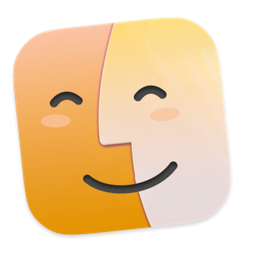

# OpenMTP Refined

**Sposta i file tra il Mac e il telefono Android via USB,<br>in un'app fatta per tutti e due.**

[](https://github.com/phantumblade/OpenMTP-Refined/releases/latest)
[](https://github.com/phantumblade/OpenMTP-Refined/releases)
[](#installazione)
[](#un-aspetto-tutto-tuo)
[](LICENSE)

<a href="https://github.com/phantumblade/OpenMTP-Refined/releases/latest"></a>

[English](README.md) · **Italiano**

</div>

<br>

<picture>
  <source media="(prefers-color-scheme: dark)" srcset="docs/images/readme/hero-dark.png">
  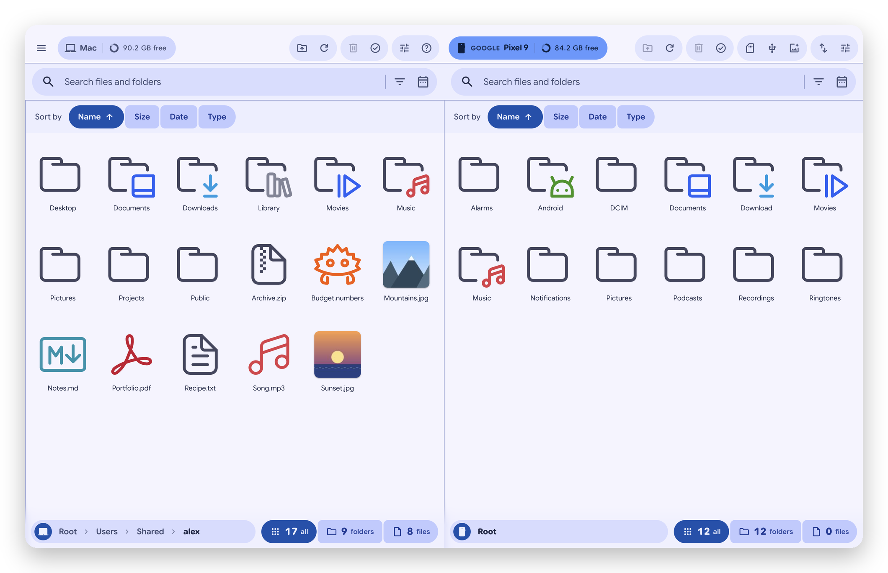
</picture>

OpenMTP Refined è un fork indipendente di [OpenMTP](https://github.com/ganeshrvel/openmtp), il file manager Android open source per macOS. Mantiene il motore MTP collaudato e rinnova tutto il resto: interfaccia **Material 3 Expressive**, una connessione al telefono che funziona e basta, **backup delle foto in un clic**, il pannello **Trasferimenti** e gli **aggiornamenti automatici**.

> [!NOTE]
> Le schermate usano un account di prova, file di prova e un telefono simulato. L'app è in italiano e in inglese; le schermate sono in inglese.

## Indice

- [In breve](#in-breve)
- [Backup delle foto in un clic](#backup-delle-foto-in-un-clic)
- [Trasferimenti che puoi seguire](#trasferimenti-che-puoi-seguire)
- [Un aspetto tutto tuo](#un-aspetto-tutto-tuo)
- [Sempre aggiornata](#sempre-aggiornata)
- [Una connessione che funziona e basta](#una-connessione-che-funziona-e-basta)
- [Installazione](#installazione) · [Collegare il telefono](#collegare-il-telefono) · [Scorciatoie da tastiera](#scorciatoie-da-tastiera)
- [Privacy](#privacy) · [Problemi frequenti](#problemi-frequenti) · [Per sviluppatori](#per-sviluppatori)

## In breve

|                                 |                                                                                                                                                                       |
| ------------------------------- | --------------------------------------------------------------------------------------------------------------------------------------------------------------------- |
| 📸 **Backup foto**              | Le foto e i video nuovi della fotocamera del telefono in una cartella del Mac, con un clic. Niente viene sovrascritto o cancellato.                                   |
| 🔁 **Pannello Trasferimenti**   | La copia in corso, i file pronti da incollare e la cronologia divisa per giorno. Le copie lunghe continuano in background.                                            |
| 🎨 **Il colore che vuoi**       | Sette colori o il colore di macOS; tema chiaro e scuro; Google Sans Flex; movimenti a molla.                                                                          |
| 🔔 **Aggiornamenti automatici** | Le nuove versioni vengono trovate, verificate e installate con un clic; un badge ti avvisa quando sono pronte.                                                        |
| 🔌 **Connessione affidabile**   | OpenMTP libera il telefono dai servizi di macOS che lo occupano e spiega ogni problema con parole semplici.                                                           |
| ⭐ **Strumenti di ogni giorno** | Cartelle preferite, filtri per data e tipo, contatori che mostrano solo cartelle o solo file, menu del tasto destro a gruppi, dimensione dell'interfaccia regolabile. |

## Backup delle foto in un clic

<table>
<tr>
<td width="42%" valign="top">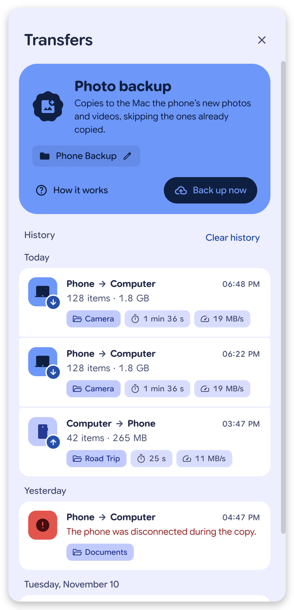</td>
<td valign="top">

Scegli una volta la cartella del Mac, poi premi **Avvia il backup**: OpenMTP confronta la cartella della fotocamera del telefono (DCIM) con quella del Mac e copia solo le foto e i video che mancano, con le stesse sottocartelle del telefono.

- I file già sul Mac vengono **saltati e mai sovrascritti**; un file con lo stesso nome ma diverso viene lasciato com'è e segnalato.
- Dal telefono **non viene mai cancellato nulla**.
- **Come funziona** spiega tutto in quattro passi illustrati.

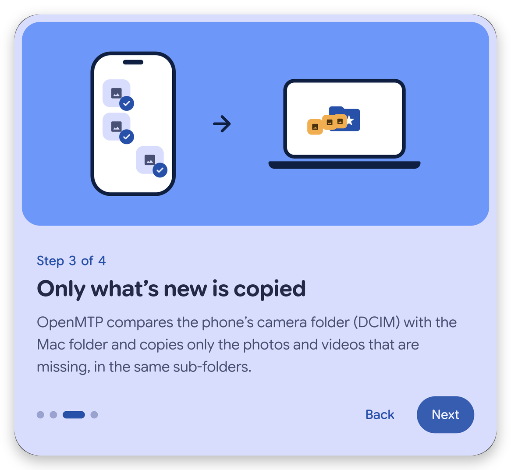

</td>
</tr>
</table>

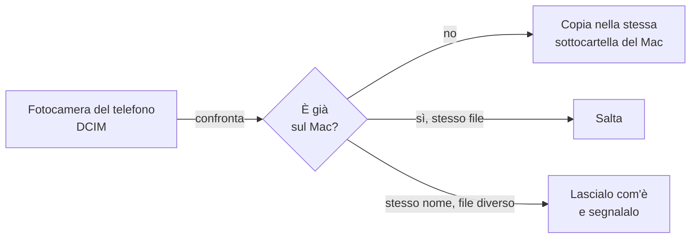

## Trasferimenti che puoi seguire

Ogni copia mostra le sue fasi (controllo, preparazione, trasferimento), il file in corso e la velocità su una barra di avanzamento ondulata, e finisce con un riepilogo.

<p align="center">
  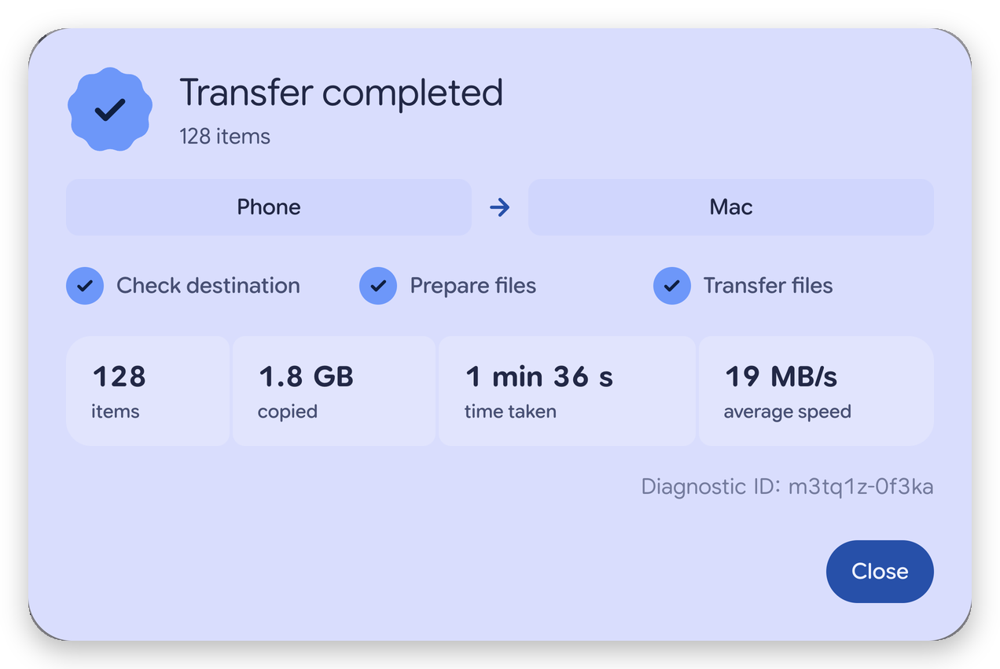
</p>

- **Continua in background**: la copia si riduce a una pillola mobile e macOS ti avvisa quando finisce.
- **Cronologia**: ogni copia con direzione, dimensione, durata, velocità media e un collegamento alla cartella di arrivo, divisa per giorno. I nomi dei file non vengono mai salvati.
- **Aggiungi alla coda**: raccogli file da più cartelle con <kbd>⇧</kbd><kbd>⌘</kbd><kbd>C</kbd>, poi incollali tutti con <kbd>⌘</kbd><kbd>V</kbd>.

## Un aspetto tutto tuo

<p align="center">
  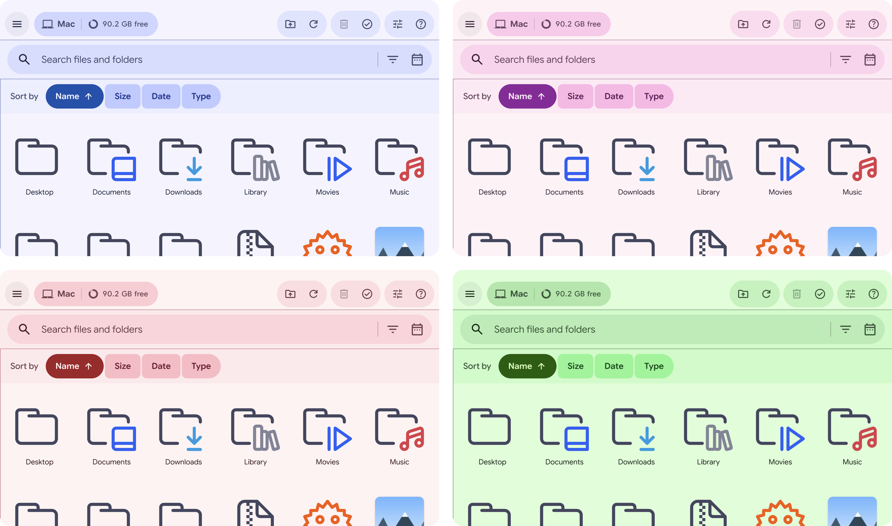
</p>

Costruita su **Material 3 Expressive**: ruoli colore generati dal colore che scegli (o dal colore di macOS), stile _Classico_ o _Vivace_, contrasto elevato quando lo chiede macOS, Google Sans Flex, forme espressive e movimenti a molla in pulsanti, interruttori, menu e riquadri.

<table>
<tr>
<td width="62%">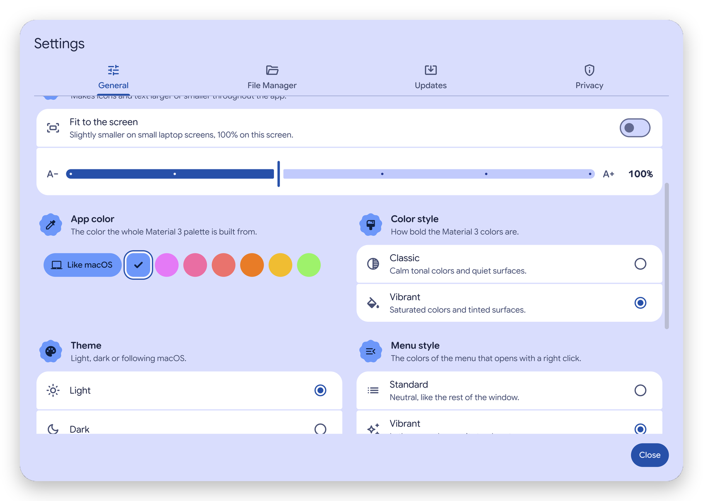</td>
<td>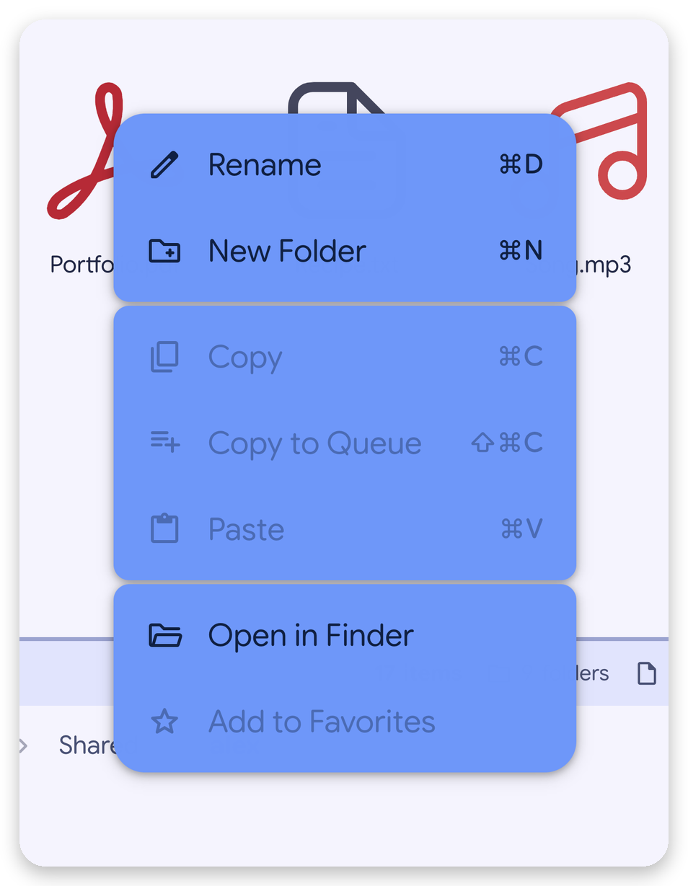</td>
</tr>
<tr>
<td align="center"><sub>Impostazioni su due colonne, interfaccia dall'80% al 130%</sub></td>
<td align="center"><sub>Menu del tasto destro, standard o nel colore dell'app</sub></td>
</tr>
</table>

## Sempre aggiornata

<table>
<tr>
<td width="30%" valign="top">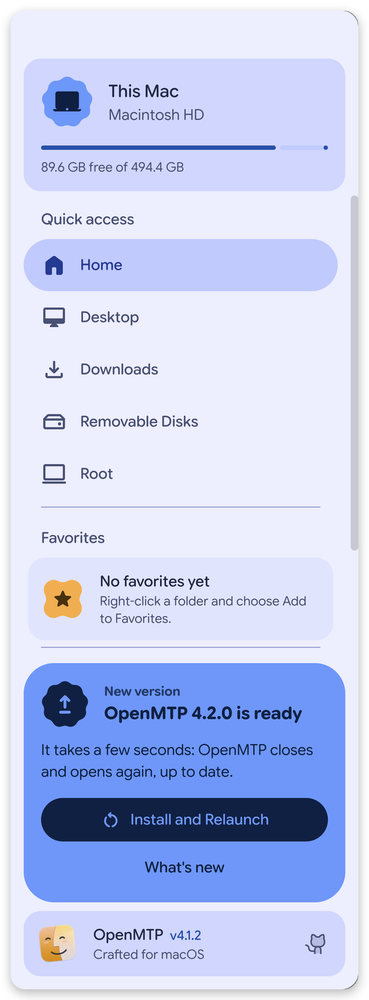</td>
<td valign="top">

OpenMTP controlla le release di questo repository all'avvio e ogni 6 ore. La nuova versione si scarica in background e **la sua impronta SHA-256 viene verificata** con quella pubblicata da GitHub prima di installare qualsiasi cosa.

Quando è pronta compare un badge sul pulsante del menu e il menu laterale propone **Installa e riapri**. Se scegli _Più tardi_, si installa quando chiudi l'app.

Dopo un aggiornamento, **Novità** mostra solo cosa è cambiato rispetto alla versione che avevi: una scheda per un aggiornamento piccolo, una griglia intera se ne hai saltati diversi.

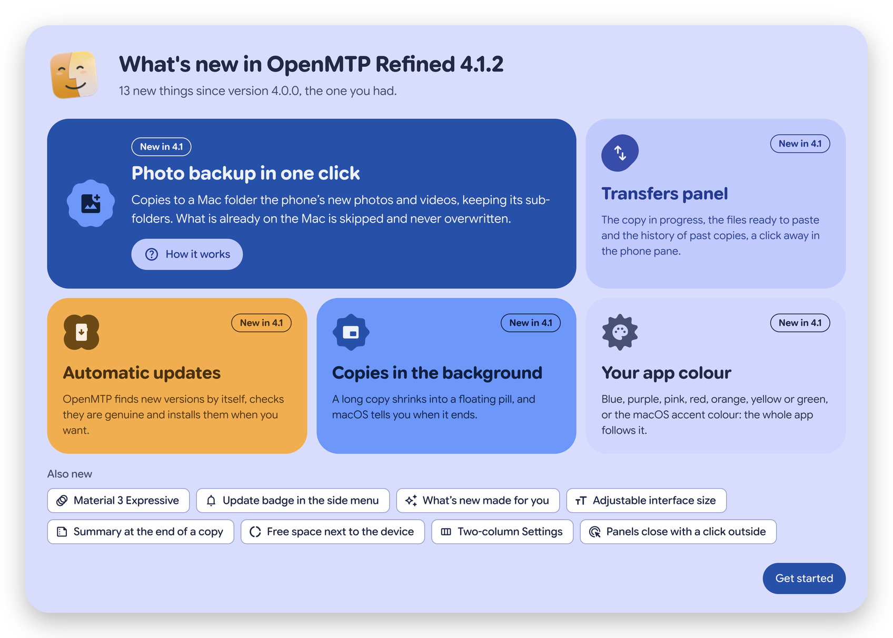

</td>
</tr>
</table>

> [!TIP]
> Per controllare subito usa **OpenMTP → Controlla aggiornamenti**. **Installa aggiornamento da file…** installa un DMG o uno ZIP che hai già. Il controllo automatico si disattiva in **Impostazioni → Aggiornamenti**.

## Una connessione che funziona e basta

<table>
<tr>
<td width="45%">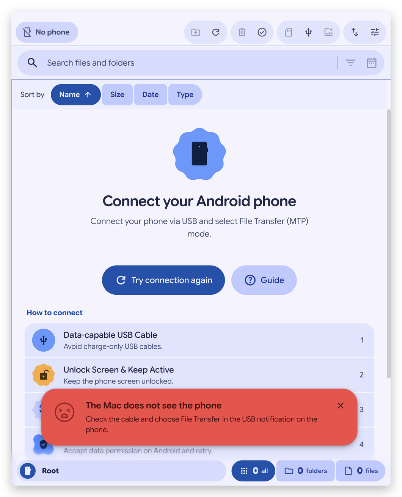</td>
<td valign="top">

Servizi di macOS come Acquisizione Immagine e Foto si prendono il telefono Android appena lo colleghi. OpenMTP lo libera, aspetta con pazienza i telefoni occupati con decine di migliaia di file e non reimposta mai la connessione USB mentre il telefono sta ancora rispondendo.

Quando qualcosa non va ricevi un messaggio chiaro e cosa fare: il cavo, la modalità _Trasferimento file_, il telefono bloccato, un'altra app che lo sta usando.

</td>
</tr>
</table>

## Installazione

**Requisiti:** Mac con Apple Silicon (M1 o successivo). Sviluppata e provata su macOS 26 Tahoe.

1. Scarica **`OpenMTP-Refined-4.1.5-arm64.dmg`** dall'[ultima release](https://github.com/phantumblade/OpenMTP-Refined/releases/latest).
2. Aprilo e trascina **OpenMTP** in **Applicazioni**.
3. Apri OpenMTP. La prima volta macOS mostra un avviso: premi **Fine**.
4. Apri **Impostazioni di Sistema → Privacy e sicurezza** e premi **Apri comunque** accanto al messaggio di OpenMTP.

> [!IMPORTANT]
> L'app è firmata in modo semplice (ad-hoc) e non è autenticata da Apple, perché servirebbe un account sviluppatore a pagamento: per questo il passo 4 serve una volta sola. Tieni l'app in **Applicazioni**: è lì che può aggiornarsi da sola.

<details>
<summary>macOS dice che l'app “è danneggiata”</summary>

Esegui questo comando nel Terminale, poi riapri l'app:

```bash
xattr -dr com.apple.quarantine /Applications/OpenMTP.app
```

</details>

## Collegare il telefono

1. Usa un cavo USB **dati**: molti cavi di ricarica portano solo corrente.
2. **Sblocca** il telefono e tieni lo schermo acceso.
3. Apri la tendina delle notifiche, tocca la notifica **USB** e scegli **Trasferimento file**.
4. Se il telefono chiede di **consentire l'accesso ai dati**, tocca **Consenti**.
5. Chiudi Android File Transfer, Acquisizione Immagine o Foto se sono aperti, poi premi **Riprova la connessione**.

## Scorciatoie da tastiera

| Azione             | Tasti                                |     | Azione               | Tasti                    |
| ------------------ | ------------------------------------ | --- | -------------------- | ------------------------ |
| Copia              | <kbd>⌘</kbd><kbd>C</kbd>             |     | Nuova cartella       | <kbd>⌘</kbd><kbd>N</kbd> |
| Aggiungi alla coda | <kbd>⇧</kbd><kbd>⌘</kbd><kbd>C</kbd> |     | Rinomina             | <kbd>⌘</kbd><kbd>D</kbd> |
| Incolla            | <kbd>⌘</kbd><kbd>V</kbd>             |     | Aggiorna             | <kbd>⌘</kbd><kbd>R</kbd> |
| Seleziona tutto    | <kbd>⌘</kbd><kbd>A</kbd>             |     | Cartella superiore   | <kbd>⌘</kbd><kbd>B</kbd> |
| Elimina            | <kbd>⌫</kbd>                         |     | Cambia pannello      | <kbd>⌘</kbd><kbd>1</kbd> |
| Apri               | <kbd>↩</kbd>                         |     | Estendi la selezione | <kbd>⇧</kbd> + frecce    |

## Privacy

OpenMTP non chiede nulla all'avvio. macOS protegge **Scrivania**, **Documenti**, **Download** e i **dischi esterni**; OpenMTP spiega ogni richiesta prima e ti fa scegliere cartella per cartella — **Continua**, **Non ora** o **Non consentire** — e puoi cambiare ogni scelta in **Impostazioni → Privacy → Accesso alle cartelle**. L'accesso completo al disco non serve mai.

Dal Mac non esce nulla, tranne i file che copi sul telefono e il controllo degli aggiornamenti, che legge le release pubbliche di questo repository.

## Problemi frequenti

| Messaggio                                        | Cosa fare                                                                                                         |
| ------------------------------------------------ | ----------------------------------------------------------------------------------------------------------------- |
| _Il Mac non vede il telefono_                    | Prova un altro cavo dati o un'altra porta USB e scegli **Trasferimento file** sul telefono.                       |
| _Nessun telefono in modalità Trasferimento file_ | Tocca la notifica USB sul telefono e scegli **Trasferimento file**.                                               |
| _Il telefono è bloccato_                         | Sbloccalo, tocca **Consenti** se richiesto e tienilo sbloccato finché compaiono i file.                           |
| _Un'altra app sta usando il telefono_            | Chiudi Android File Transfer, Acquisizione Immagine, Foto o Smart Switch e riprova.                               |
| _Il telefono non ha risposto_                    | Scollega il cavo, sblocca il telefono, ricollegalo e riprova.                                                     |
| Continua a non funzionare                        | In **Impostazioni → Generali → Connessione al telefono** passa da **Kalam** a **Legacy** (o viceversa) e riprova. |

Il pulsante **Guida** nella schermata di connessione apre un aiuto più dettagliato.

## Per sviluppatori

<details>
<summary>Compilare, provare e pubblicare</summary>

Requisiti: Node.js 16+, Yarn 1.22, Xcode Command Line Tools, e Go per ricompilare il modulo nativo Kalam.

```bash
yarn install --frozen-lockfile
```

```bash
yarn dev
```

`yarn test` esegue il lint, i controlli di comportamento e i test Go. `yarn package-mac-local` crea un'app firmata ad-hoc e mette DMG e ZIP in `dist/`. `OPENMTP_NO_PHONE=1` avvia una build che non tocca mai l'USB, per provare l'interfaccia accanto a un'altra OpenMTP.

**Pubblicare.** Alza `version` in `package.json`, registra le novità visibili in `app/containers/Onboarding/whatsNewItems.js` con quella versione, fai la build e pubblica una release GitHub con il tag `vX.Y.Z` e DMG e ZIP allegati. I nomi dei file devono contenere l'architettura (`-arm64.zip`): l'app installa solo la build per il suo Mac, e solo se l'impronta coincide con quella mostrata da GitHub.

Le regole di design sono in [DESIGN.md](DESIGN.md); ogni modifica è nel [CHANGELOG](CHANGELOG.md).

</details>

## Crediti e licenza

OpenMTP è stato creato da [Ganesh Rathinavel](https://github.com/ganeshrvel) ed è distribuito con licenza MIT. OpenMTP Refined, di [Andrea Perini](https://github.com/phantumblade), mantiene la storia e il copyright originali ed è distribuito con la stessa licenza.

[LICENSE](LICENSE) · [NOTICE](NOTICE.md) · [Note di terze parti](THIRD_PARTY_NOTICES/) (Material Symbols, Google Sans Flex, icone Catppuccin, Phosphor, Lucide, shape-morph, Faculty Glyphic) · [Sicurezza](SECURITY.md)

<sub>OpenMTP Refined non è affiliato a Google, Samsung o Apple. Android è un marchio di Google LLC.</sub>
