<div align="center">


# OpenMTP Refined

**Move files between your Mac and your Android phone over USB,<br>in an app that feels made for both.**

[](https://github.com/phantumblade/OpenMTP-Refined/releases/latest)
[](https://github.com/phantumblade/OpenMTP-Refined/releases)
[](#install)
[](#a-look-of-your-own)
[](LICENSE)

<a href="https://github.com/phantumblade/OpenMTP-Refined/releases/latest"></a>

**English** · [Italiano](README.it.md)

</div>

<br>

<picture>
  <source media="(prefers-color-scheme: dark)" srcset="docs/images/readme/hero-dark.png">
  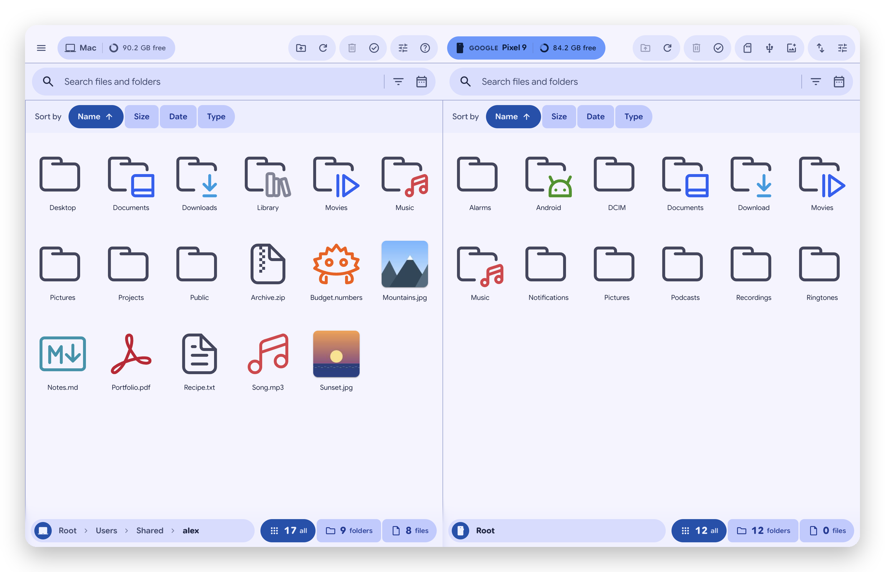
</picture>

OpenMTP Refined is an independent fork of [OpenMTP](https://github.com/ganeshrvel/openmtp), the open-source Android file manager for macOS. It keeps the proven MTP engine and rebuilds everything around it: a **Material 3 Expressive** interface, a phone connection that just works, **one-click photo backup**, a **Transfers** panel and **automatic updates**.

> [!NOTE]
> Screenshots use a demo account, demo files and a simulated phone.

## Contents

- [Highlights](#highlights)
- [Photo backup in one click](#photo-backup-in-one-click)
- [Transfers you can follow](#transfers-you-can-follow)
- [A look of your own](#a-look-of-your-own)
- [Always up to date](#always-up-to-date)
- [A connection that just works](#a-connection-that-just-works)
- [Install](#install) · [Connect your phone](#connect-your-phone) · [Keyboard shortcuts](#keyboard-shortcuts)
- [Privacy](#privacy) · [Troubleshooting](#troubleshooting) · [For developers](#for-developers)

## Highlights

|                            |                                                                                                                  |
| -------------------------- | ---------------------------------------------------------------------------------------------------------------- |
| 📸 **Photo backup**        | New photos and videos from the phone's camera to a Mac folder, in one click. Nothing is overwritten or deleted.  |
| 🔁 **Transfers panel**     | The copy in progress, files ready to paste and a history grouped by day. Long copies continue in the background. |
| 🎨 **Your app colour**     | Seven colours or the macOS accent colour; light and dark themes; Google Sans Flex; spring motion.                |
| 🔔 **Automatic updates**   | New versions are found, verified and installed with one click; a badge tells you when one is ready.              |
| 🔌 **Reliable connection** | OpenMTP frees the phone from macOS services that grab it, and explains every problem in plain words.             |
| ⭐ **Everyday tools**      | Favourite folders, filters by date and type, a grouped right-click menu, adjustable interface size.              |

## Photo backup in one click

<table>
<tr>
<td width="42%" valign="top">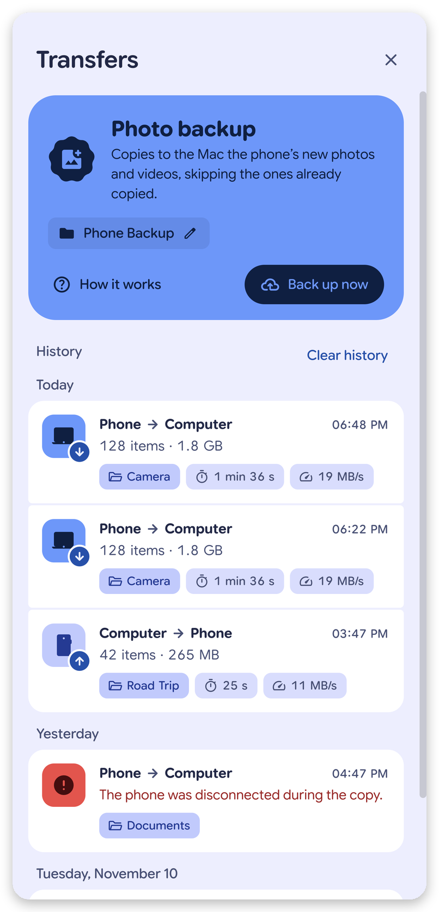</td>
<td valign="top">

Choose a Mac folder once, then press **Back up now**: OpenMTP compares the phone's camera folder (DCIM) with it and copies only the photos and videos that are missing, keeping the phone's sub-folders.

- Files already on the Mac are **skipped and never overwritten**; a file with the same name but different content is left alone and reported.
- **Nothing is ever deleted** from the phone.
- **How it works** walks through the whole thing in four illustrated steps.

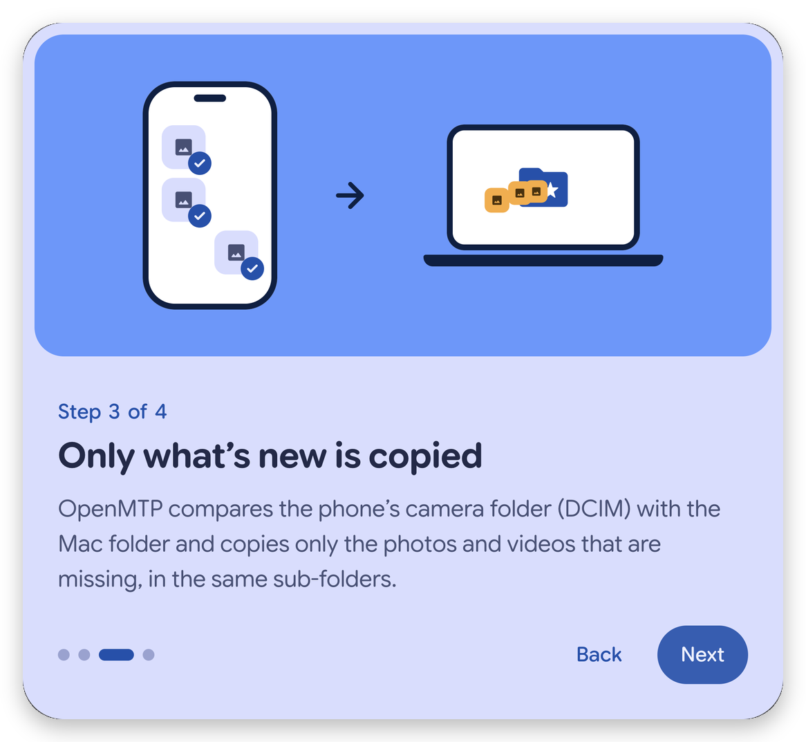

</td>
</tr>
</table>

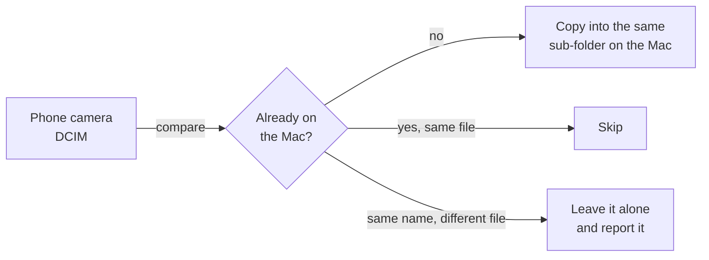

## Transfers you can follow

Every copy shows its steps (check, prepare, transfer), the file being copied and its speed on a wavy progress bar, and ends with a summary.

<p align="center">
  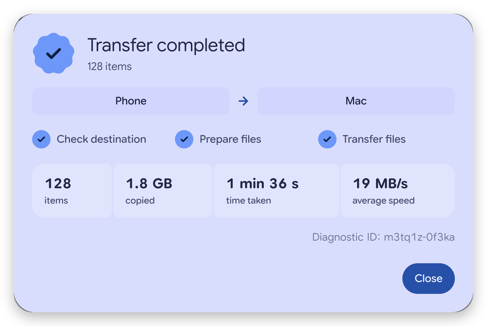
</p>

- **Continue in the background**: the copy shrinks into a floating pill and macOS notifies you when it ends.
- **History**: each copy with direction, size, time taken, average speed and a shortcut to the destination folder, grouped by day. File names are never stored.
- **Copy to queue**: collect files from several folders with <kbd>⇧</kbd><kbd>⌘</kbd><kbd>C</kbd>, then paste them all with <kbd>⌘</kbd><kbd>V</kbd>.

## A look of your own

<p align="center">
  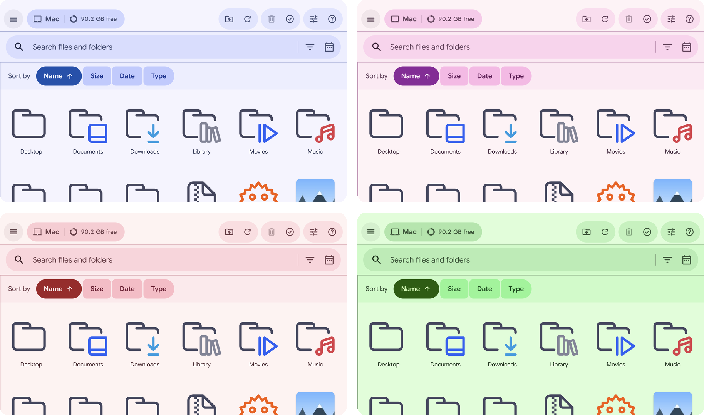
</p>

Built on **Material 3 Expressive**: colour roles generated from the colour you pick (or the macOS accent colour), _Classic_ or _Vibrant_ styles, high contrast when macOS asks for it, Google Sans Flex, expressive shapes and spring motion in buttons, switches, menus and tiles.

<table>
<tr>
<td width="62%">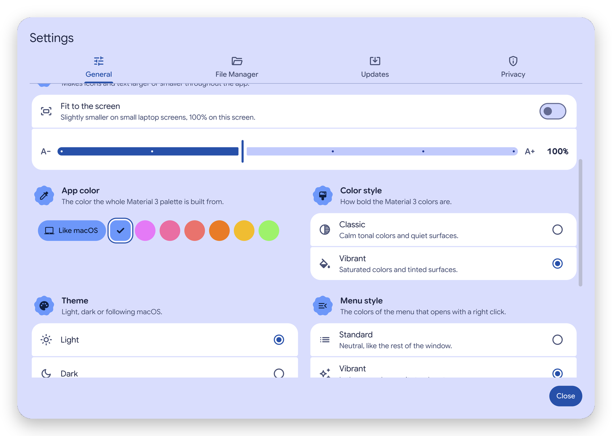</td>
<td>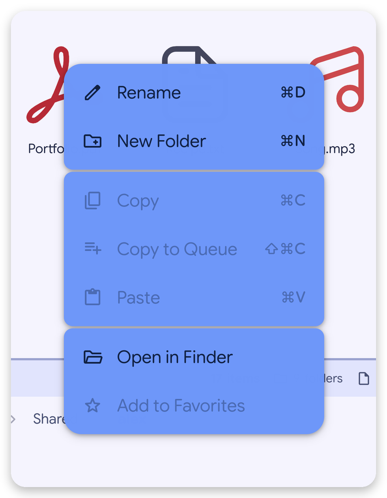</td>
</tr>
<tr>
<td align="center"><sub>Settings in two columns, interface size from 80% to 130%</sub></td>
<td align="center"><sub>Right-click menu, standard or in the app colour</sub></td>
</tr>
</table>

## Always up to date

<table>
<tr>
<td width="30%" valign="top">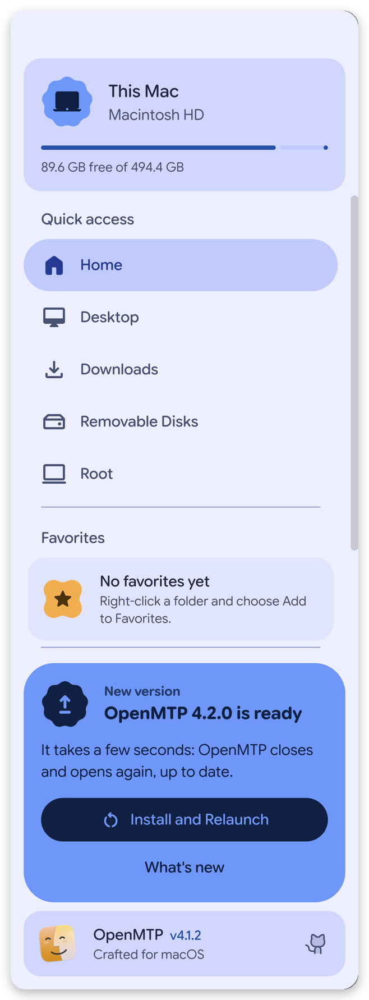</td>
<td valign="top">

OpenMTP checks this repository's releases at launch and every 6 hours. A new version is downloaded in the background and **its SHA-256 checksum is verified** against the one GitHub publishes before anything is installed.

When it is ready, a badge appears on the menu button and the side menu offers **Install and Relaunch**. Choose _Later_ and it installs when you quit.

After an update, **What's new** shows only what changed since the version you had: one card for a small update, a full grid if you skipped a few.

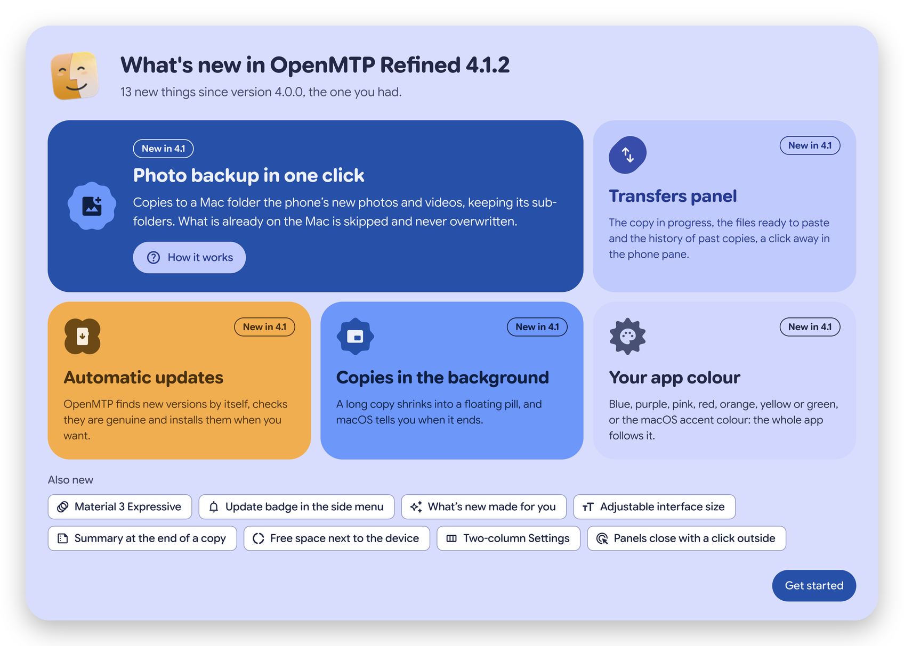

</td>
</tr>
</table>

> [!TIP]
> To check right away, use **OpenMTP → Check For Updates**. **Install Update from File…** installs a DMG or ZIP you already have. Automatic checks can be turned off in **Settings → Updates**.

## A connection that just works

<table>
<tr>
<td width="45%">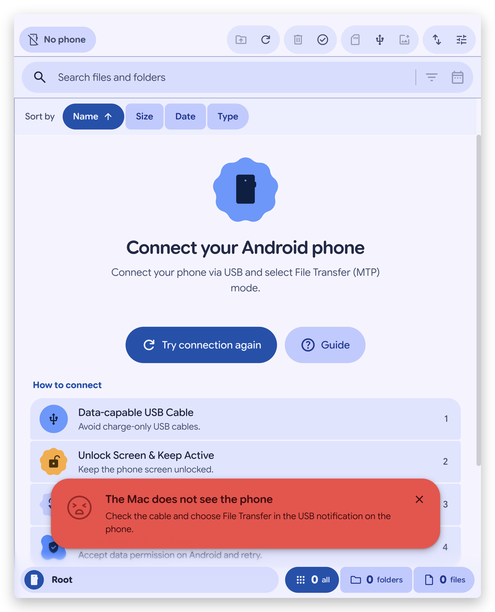</td>
<td valign="top">

macOS services such as Image Capture and Photos grab Android phones the moment they are plugged in. OpenMTP releases the phone, waits patiently for busy phones with tens of thousands of files, and never resets the USB connection while the phone is still answering.

When something goes wrong you get a plain message and what to do next: cable, _File transfer_ mode, a locked phone, another app holding it.

</td>
</tr>
</table>

## Install

**Requirements:** a Mac with Apple Silicon (M1 or newer). Developed and tested on macOS 26 Tahoe.

1. Download **`OpenMTP-Refined-4.1.2-arm64.dmg`** from the [latest release](https://github.com/phantumblade/OpenMTP-Refined/releases/latest).
2. Open it and drag **OpenMTP** into **Applications**.
3. Open OpenMTP. The first time macOS shows a warning: click **Done**.
4. Open **System Settings → Privacy & Security** and click **Open Anyway** next to the OpenMTP message.

> [!IMPORTANT]
> The app is ad-hoc signed, not notarized by Apple (that needs a paid developer account), which is why step 4 is needed once. Keep the app in **Applications**: that's where it can update itself.

<details>
<summary>macOS says the app “is damaged”</summary>

Run this in Terminal, then open the app again:

```bash
xattr -dr com.apple.quarantine /Applications/OpenMTP.app
```

</details>

## Connect your phone

1. Use a **data** USB cable — many charging cables carry power only.
2. **Unlock** the phone and keep the screen on.
3. Pull down the notifications, tap the **USB** notification and choose **File transfer**.
4. If the phone asks to **allow access to phone data**, tap **Allow**.
5. Quit Android File Transfer, Image Capture or Photos if they are open, then click **Try connection again**.

## Keyboard shortcuts

| Action        | Keys                                 |     | Action           | Keys                     |
| ------------- | ------------------------------------ | --- | ---------------- | ------------------------ |
| Copy          | <kbd>⌘</kbd><kbd>C</kbd>             |     | New folder       | <kbd>⌘</kbd><kbd>N</kbd> |
| Copy to queue | <kbd>⇧</kbd><kbd>⌘</kbd><kbd>C</kbd> |     | Rename           | <kbd>⌘</kbd><kbd>D</kbd> |
| Paste         | <kbd>⌘</kbd><kbd>V</kbd>             |     | Refresh          | <kbd>⌘</kbd><kbd>R</kbd> |
| Select all    | <kbd>⌘</kbd><kbd>A</kbd>             |     | Folder up        | <kbd>⌘</kbd><kbd>B</kbd> |
| Delete        | <kbd>⌫</kbd>                         |     | Switch pane      | <kbd>⌘</kbd><kbd>1</kbd> |
| Open          | <kbd>↩</kbd>                         |     | Extend selection | <kbd>⇧</kbd> + arrows    |

## Privacy

OpenMTP asks for nothing when it starts. macOS protects **Desktop**, **Documents**, **Downloads** and **external disks**; OpenMTP explains each request first and lets you choose folder by folder — **Continue**, **Not now** or **Don't allow** — and you can change every choice in **Settings → Privacy → Folder access**. Full Disk Access is never needed.

Nothing leaves your Mac except the files you copy to your phone, and the update check that reads this repository's public releases.

## Troubleshooting

| Message                          | What to do                                                                                         |
| -------------------------------- | -------------------------------------------------------------------------------------------------- |
| _The Mac does not see the phone_ | Try another data cable or USB port, and choose **File transfer** on the phone.                     |
| _No phone in File Transfer mode_ | Tap the USB notification on the phone and choose **File transfer**.                                |
| _The phone is locked_            | Unlock it, tap **Allow** if asked, and keep it unlocked until the files appear.                    |
| _Another app is using the phone_ | Quit Android File Transfer, Image Capture, Photos or Smart Switch, then retry.                     |
| _The phone did not respond_      | Unplug the cable, unlock the phone, plug it back in and retry.                                     |
| Still not working                | In **Settings → General → Phone connection**, switch between **Kalam** and **Legacy**, then retry. |

The **Guide** button on the connection screen opens more detailed help.

## For developers

<details>
<summary>Build, test and release</summary>

Requirements: Node.js 16+, Yarn 1.22, Xcode Command Line Tools, and Go to rebuild the native Kalam module.

```bash
yarn install --frozen-lockfile
```

```bash
yarn dev
```

`yarn test` runs the lint, the behaviour checks and the Go tests. `yarn package-mac-local` builds an ad-hoc signed app and writes the DMG and ZIP to `dist/`. `OPENMTP_NO_PHONE=1` starts a build that never touches USB, for UI tests next to another OpenMTP.

**Releasing.** Raise `version` in `package.json`, register the user-facing changes in `app/containers/Onboarding/whatsNewItems.js` with that version, build, and publish a GitHub release tagged `vX.Y.Z` with the DMG and ZIP attached. File names must contain the architecture (`-arm64.zip`): the app installs only the build for its own Mac, and only if its checksum matches the one GitHub shows.

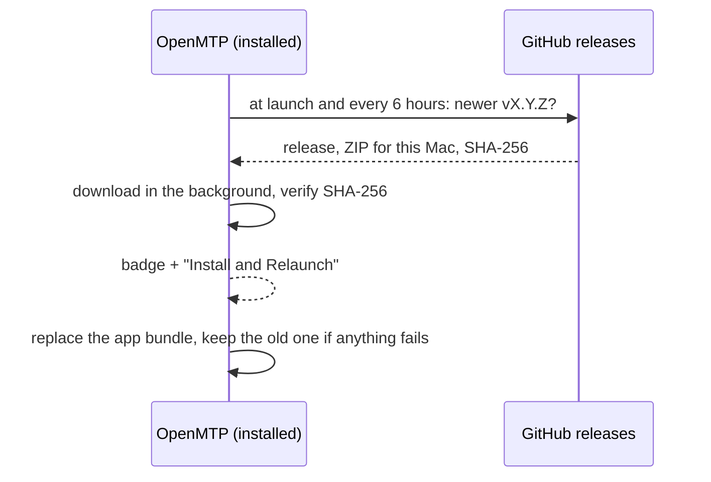

```text
app/components/m3/         Material 3 Expressive components
app/containers/HomePage/   File panes, connection screen, Transfers, photo backup
app/containers/Onboarding/ What's new (whatsNewItems.js) and the welcome
app/helpers/               Connection, transfers, updates, favourites, dates
app/styles/m3/             Generated colour roles and design tokens
ffi/kalam/                 Native MTP engine (Go) and its bridge
scripts/                   Build, colour generation and verification scripts
```

Design rules live in [DESIGN.md](DESIGN.md); every change is listed in the [CHANGELOG](CHANGELOG.md).

</details>

## Credits and license

OpenMTP was created by [Ganesh Rathinavel](https://github.com/ganeshrvel) and is released under the MIT license. OpenMTP Refined, by [Andrea Perini](https://github.com/phantumblade), keeps the original history and copyright and is released under the same license.

[LICENSE](LICENSE) · [NOTICE](NOTICE.md) · [Third-party notices](THIRD_PARTY_NOTICES/) (Material Symbols, Google Sans Flex, Catppuccin icons, Phosphor, Lucide, shape-morph, Faculty Glyphic) · [Security](SECURITY.md)

<sub>OpenMTP Refined is not affiliated with Google, Samsung or Apple. Android is a trademark of Google LLC.</sub>
